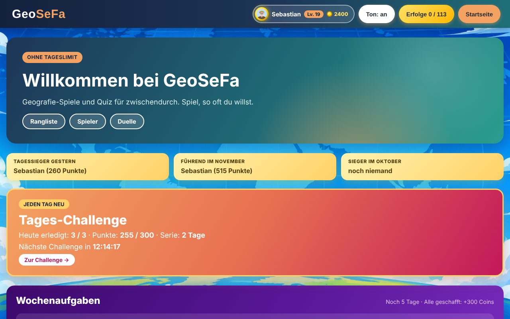
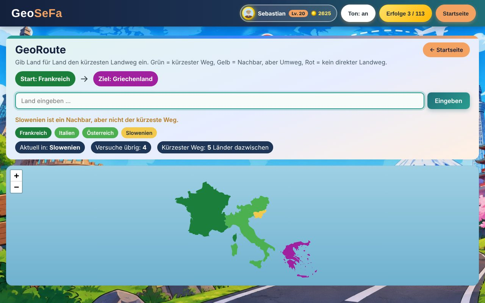
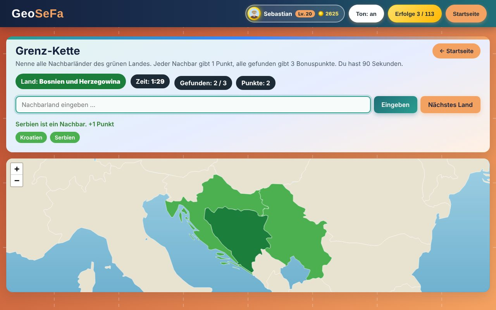
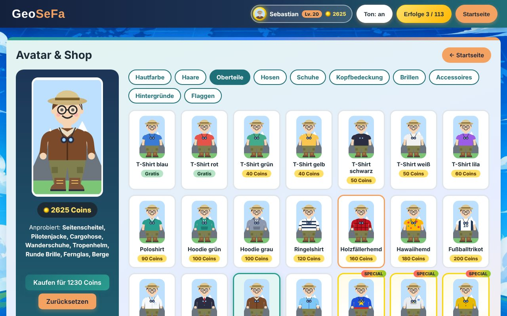
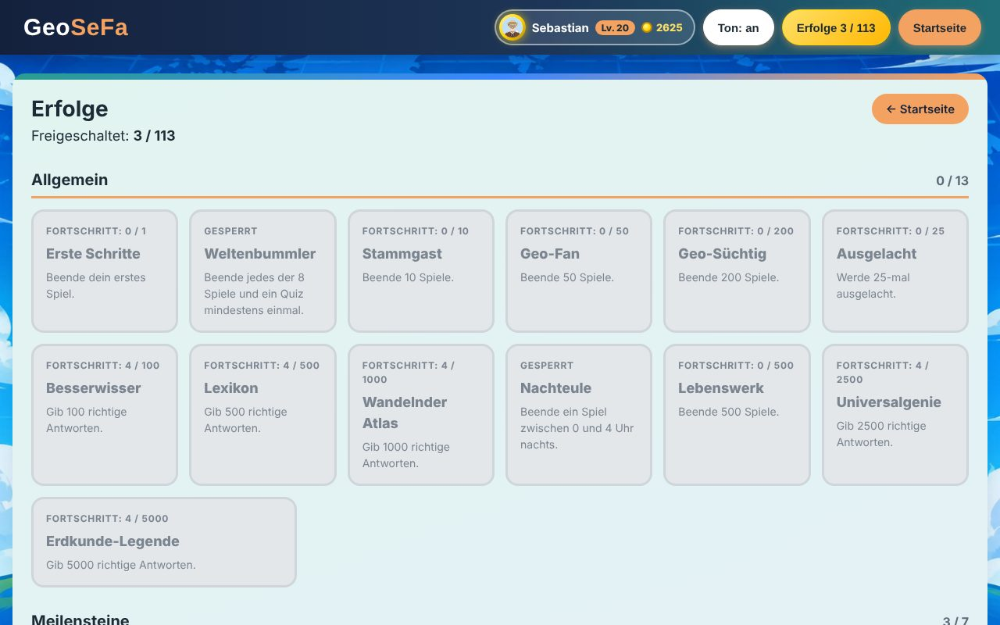
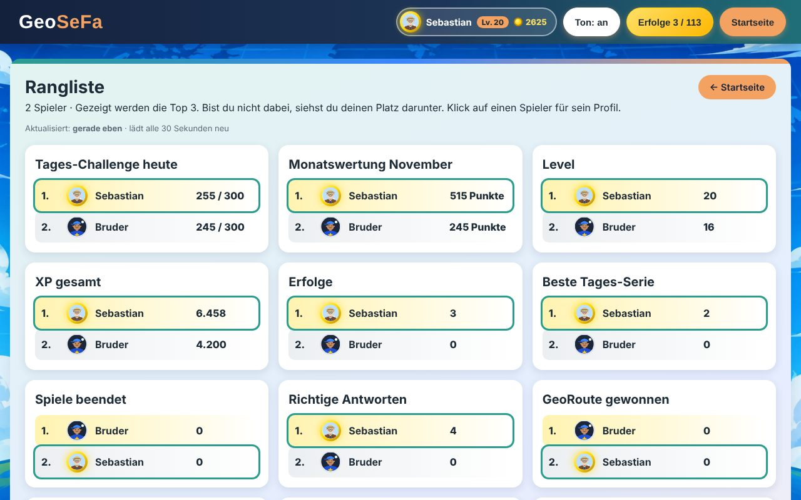

# GeoSeFa

GeoSeFa ist ein Geografie-Spiel im Browser – inspiriert von Geotrivia, aber ohne Tageslimit. Es gibt acht Spielmodi, Quiz, eine tägliche Challenge, Wochenaufgaben, Erfolge, einen Avatar-Shop, eine gemeinsame Rangliste und Duelle gegen andere Spieler (live oder als Herausforderung).

**Live spielen:** https://sebabuch.github.io/GeoSeFa/



## Funktionen

### Spiele
| Spiel | Worum es geht |
| --- | --- |
| **GeoRoute** | Den kürzesten Landweg von einem Start- zu einem Zielland finden. |
| **GeoSize** | Schätzen, wie groß zwei Länder im Verhältnis zueinander sind. |
| **GeoDecide** | Mehr oder weniger? Einwohner, Fläche, Dichte, Nachbarn – so lange wie möglich richtig liegen. |
| **Geodle** | Ein Land erraten, jeder Versuch gibt Hinweise (Kontinent, Nachbar, Einwohner, Fläche). |
| **GeoConnections** | 16 Begriffe in vier Gruppen sortieren, die jeweils zu einem Land gehören. |
| **GeoDistanz** | Ein Land finden, dessen Hauptstadt eine bestimmte Entfernung von der Start-Hauptstadt hat. |
| **Grenz-Kette** | In 90 Sekunden möglichst viele Nachbarländer nennen. |
| **Blitzrunde** | 60 Sekunden Flaggen, Hauptstädte oder Umrisse. |

Dazu acht **Quiz-Modi** (Länder auf der Karte, Eintippen, Umrisse, Flaggen, Hauptstädte) mit Regionen, Zeitlimit und einem **Fehler-Training**, das gezielt die Länder abfragt, die man oft falsch hat.




### Fortschritt
- **Tages-Challenge** mit drei Aufgaben, für alle Spieler gleich (deterministischer Zufall über einen Seed), Serie, Kalender und Countdown.
- **Wochenaufgaben** mit Coins als Belohnung.
- **113 Erfolge** in Bronze, Silber, Gold und Platin – darunter versteckte Erfolge.
- **Level, XP und Ränge** (nach bester Tages-Serie).
- **Avatar-Shop** mit über 140 Teilen (Haare, Kleidung, Hüte, Brillen, Accessoires, Hintergründe, Flaggen), Special- und Saison-Items. Die Figur ist komplett als SVG gezeichnet.




### Online
- **Konto** mit E-Mail und Passwort, Spielstand wird automatisch online gespeichert und auf allen Geräten geladen.
- **Rangliste** (Top 3 pro Kategorie, Tages- und Monatswertung, Tagessieger) mit automatischer Aktualisierung.
- **Spielerprofile** mit Rekord-Vergleich und Erfolgsliste.
- **Duelle**: live gegeneinander mit Live-Punktestand oder als Herausforderung, die der andere später spielt. Beide bekommen exakt dieselben Fragen.



## Technik

- **HTML, CSS, JavaScript** ohne Framework und ohne Build-Tool
- **Klassen mit Vererbung** – jedes Spiel erbt von `BaseGame`
- **Leaflet** für die interaktive Karte, **Natural Earth** GeoJSON für die Länderumrisse
- **REST Countries API** (v5) für Länderdaten, mit Zwischenspeicher im `localStorage`
- **Firebase Authentication und Realtime Database über die REST-Schnittstelle** (`fetch` mit `async`/`await`, kein Firebase-SDK)
- **Seeded Random** (Park-Miller-Generator), damit Tages-Challenge und Duelle für alle Spieler gleich sind
- Eigene SVG-Grafiken für Avatar und Hintergründe
- Layout mit Flexbox, Templates und Logik strikt getrennt

## Ordnerstruktur

```
js/
  data/        feste Daten (Erfolge, Shop-Artikel, Wochenaufgaben, Duelle, Level)
  models/      Klassen: Spiele, Quiz, Dienste (Speicher, Konto, Cloud, Sync, Shop, Duelle)
  templates/   HTML-Templates (nur Rückgabe von HTML, keine Logik)
  pages/       Seitenaufbau (Profil, Shop, Erfolge, Login, Rangliste, Duelle)
  game.js      Start und Navigation
css/           Styles pro Bereich
data/          countries.geojson (Natural Earth)
libs/leaflet/  Leaflet
sounds/        Soundeffekte
firebase-rules.json  Sicherheitsregeln für die Realtime Database
```

## Selbst einrichten

1. **REST Countries:** Kostenlosen API-Key auf https://restcountries.com erstellen und die eigene Adresse als Origin freigeben.
2. **Firebase:** Projekt anlegen, *Authentication → E-Mail/Passwort* aktivieren, *Realtime Database* anlegen und den Inhalt von `firebase-rules.json` als Regeln veröffentlichen.
3. In `js/config.js` `API_KEY`, `FIREBASE_API_KEY` und `FIREBASE_DB_URL` eintragen.
4. Leaflet nach `libs/leaflet/` und `ne_50m_admin_0_countries.geojson` als `data/countries.geojson` ablegen.
5. Mit einem lokalen Server starten (z. B. Live Server in VS Code).

## Quellen

- Länderdaten und Flaggen: [REST Countries](https://restcountries.com)
- Länderumrisse: [Natural Earth](https://www.naturalearthdata.com) (gemeinfrei)
- Karte: [Leaflet](https://leafletjs.com) (BSD-2-Clause)

Privates, nicht-kommerzielles Hobbyprojekt von Sebastian Buchholz.
